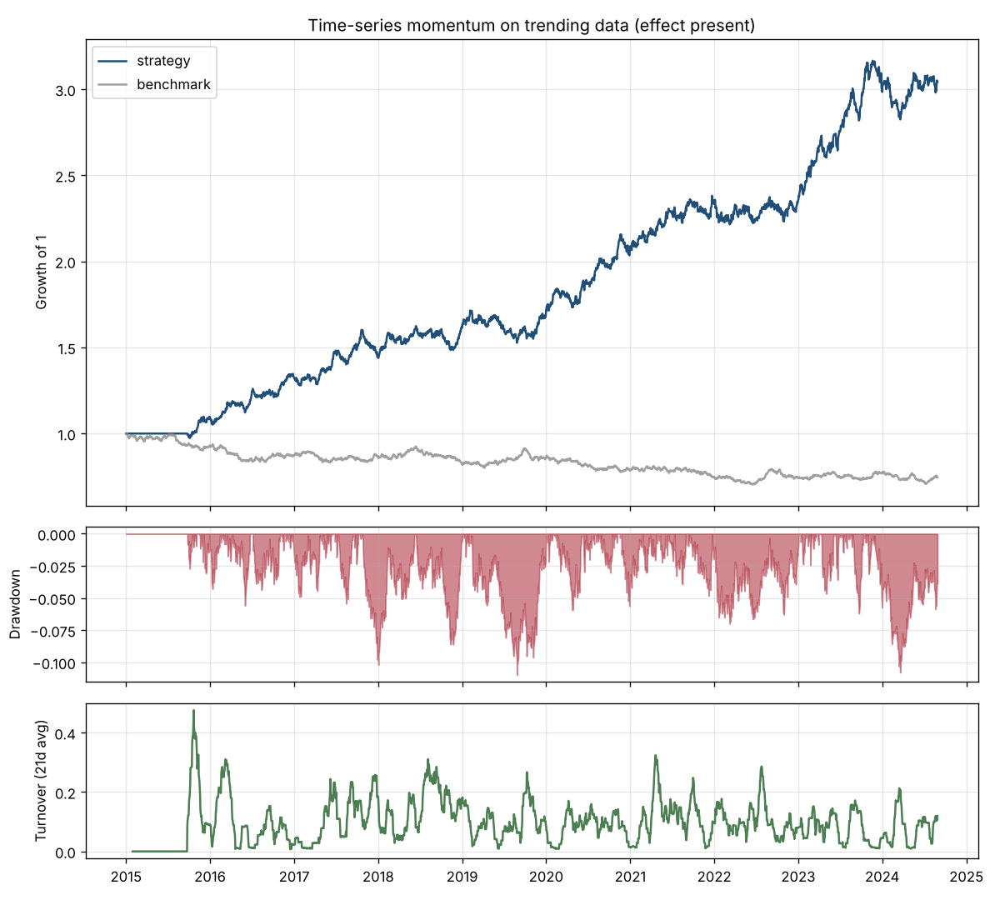

# quant-backtester

**A small backtesting engine that is harder to fool than its user.**

Most backtests are wrong in one of three ways: they peek at the future, they ignore what trading costs, or they report the best of many tries as if it were the only try. This repository is a daily-frequency simulator for securities strategies built around defenses against all three, with tests that pin each defense down.

```sh
pip install -e .[dev]
python -m pytest
python -m qbt run configs/pairs_cointegrated.toml --plot pairs.png
python -m qbt walk-forward configs/momentum_random_walk.toml
```

Pure Python with NumPy and pandas. Matplotlib is optional, for figures. No API keys, no accounts; the examples run on synthetic data with known structure so that every claim below is reproducible from a seed.

## What it does

| Layer | Module | Contents |
| :--- | :--- | :--- |
| Simulation | `qbt/engine.py` | Daily cash-and-shares accounting, decided-at-close / executed-next-close timing, linear and square-root costs, borrow and cash financing, rebalance thresholds |
| Signals | `qbt/signals.py` | Time-series momentum, cross-sectional momentum, short-horizon mean reversion, pairs trading with rolling OLS hedge ratios |
| Portfolio | `qbt/portfolio.py` | Weight caps, gross exposure limit, trailing-volatility targeting |
| Statistics | `qbt/stats.py` | Sharpe with Lo (2002) standard error, drawdowns, block-bootstrap intervals, probabilistic and deflated Sharpe ratio (Bailey and Lopez de Prado) |
| Validation | `qbt/validation.py` | Grid search, rolling and anchored walk-forward with the search repeated inside every training window |
| Data | `qbt/synthetic.py`, `qbt/data.py` | Random walks with volatility regimes, trending drifts, cointegrated pairs; CSV loaders with gap checks; a Stooq downloader |

## The three defenses

**1. Time only moves forward.** A signal function returns the weight it *decides* at the close of day t. The engine shifts it by `execution_lag` (at least one bar, enforced) before trading. Every signal and overlay is tested by truncation: computing weights on `prices[:t]` must reproduce the first t rows of the weights computed on the full history. The engine has the same test: perturbing prices after day t cannot change any trade before it. Walk-forward has it too: a fold whose train and test windows end before a perturbation must produce identical parameters and returns.

**2. Costs are paid on the day they occur.** The simulator holds cash plus fractional shares and marks to market every close. Trades pay commission and half-spread in basis points of traded notional, optionally plus square-root market impact against volume. Shorts pay borrow daily; cash earns or pays its rate. Returns are computed on post-cost equity, so a high-turnover idea is penalized exactly where it should be. The test suite checks the cost on a known trade to the cent.

**3. Selection is counted.** `walk_forward` repeats the whole grid search inside each training window and reports the stitched out-of-sample returns, next to the inflated in-sample number. The deflated Sharpe ratio then asks how likely a Sharpe this large is given how many configurations were tried and how dispersed their results were. A test asserts that on pure noise the best in-sample Sharpe is positive while walk-forward is not.

## Results on synthetic data

All runs use 1 bp commission plus 2.5 bps half-spread per side, one-day execution lag, ten years of daily data, and walk-forward with three-year training and one-year test windows (seven folds, grid search redone in each). Reproduce any row with the config file named in it.

| Config | Data | Fixed-parameter Sharpe | Best in-sample Sharpe (grid) | Walk-forward Sharpe | Deflated Sharpe P(SR > 0) |
| :--- | :--- | ---: | ---: | ---: | ---: |
| `momentum_random_walk` | random walk, 8 assets | -0.04 | 0.35 | -0.57 | 0.9% |
| `mean_reversion_random_walk` | random walk, 8 assets | -1.04 | -0.56 | -0.22 | 6.1% |
| `momentum_trending` | AR(1) drifts, 8 assets | 1.20 | 1.28 | 0.55 | 22.9% |
| `pairs_cointegrated` | OU spread, half-life 10 days | 0.91 | 1.43 | 1.14 | 95.8% |

Reading the table top to bottom:

- **Momentum on a random walk** has no edge by construction. The grid still finds an in-sample Sharpe of 0.35 by picking the luckiest lookback; walking forward turns it negative because costs are real and the edge is not.
- **Mean reversion on a random walk** turns over 144 times a year. At 3.5 bps per side that is a guaranteed loss of about 10% a year, which the simulator reports as a Sharpe of -1. Costs, not signal quality, decide this strategy.
- **Momentum on trending data** has a real effect. The fixed configuration earns a Sharpe of 1.2 with a bootstrap interval of [0.58, 1.81]. Walk-forward keeps a positive 0.55, but the deflated Sharpe says that seven years of out-of-sample data after a twelve-point grid search is not enough to be confident. That is the honest answer, and it is the number a reviewer should ask for.
- **Pairs trading on a cointegrated pair** is the clearest signal: the spread is stationary by construction and the strategy is short-horizon, so the out-of-sample Sharpe barely degrades and the deflated probability is high.



The figure shows growth of 1, drawdown, and 21-day average turnover for the trending momentum run against an equal-weight buy-and-hold benchmark.

## Using it on real data

```sh
python -m qbt download data/etf spy.us tlt.us gld.us efa.us   # free daily data from Stooq
```

Then point a config at the directory (`kind = "ohlcv_dir"`, `path = "data/etf"`) or at any wide CSV with a date column and one column per ticker. `qbt.data.align` keeps the common date range, forward-fills gaps of at most five sessions, and refuses longer ones rather than trading stale prices. The downloader is not covered by tests because it needs network access; its parser is.

## Writing a strategy

A strategy is any function from a price frame to a weight frame with the same index and columns:

```python
import pandas as pd
from qbt import Costs, run_backtest, summarize

def my_signal(prices: pd.DataFrame) -> pd.DataFrame:
    fast, slow = prices.rolling(20).mean(), prices.rolling(100).mean()
    raw = (fast > slow).astype(float) - (fast < slow).astype(float)
    return raw.div(raw.abs().sum(axis=1).clip(lower=1), axis=0)   # gross exposure at most one

result = run_backtest(prices, my_signal(prices), Costs(commission_bps=1, half_spread_bps=2.5))
print(summarize(result.returns, result.turnover))
```

Register it in `qbt.signals.REGISTRY` to drive it from a TOML config and the walk-forward CLI. Add a case to `tests/test_signals.py::CASES` and the truncation test will check it for look-ahead automatically.

## Design notes

[docs/design.md](docs/design.md) walks through the timing convention with a worked example, the accounting equations, the statistics with their references, and the walk-forward construction. It also lists what this engine deliberately does not do.

## Limits

Daily bars and close-to-close execution; no intraday fills, limit orders, or partial fills. One currency. Fractional shares, no lot sizes. Linear costs plus an optional square-root impact model, both with constant parameters. Survivorship bias is the user's problem: the loaders take whatever universe they are given. The synthetic generators are for testing the machinery, not for estimating what any real strategy earns.
